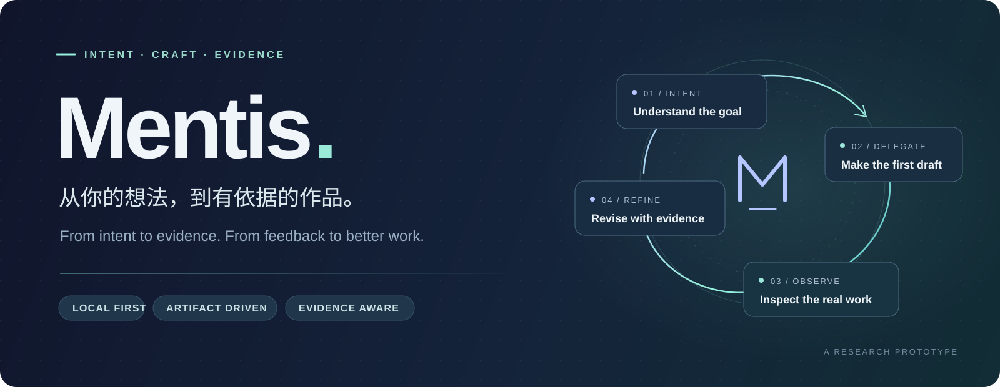
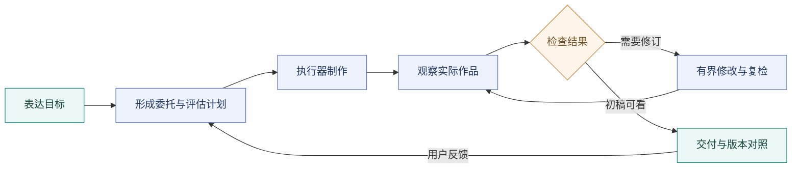

<div align="center">



<br />

**代表非专业用户，与执行型 Agent 持续协作。**

你表达目标与反馈，Mentis 组织委托、观察作品，并推动有依据的修订。

[](#快速开始) [](#架构) [](docs/WORKBENCH_GUIDE.md) [](#验证与边界)

[快速开始](#快速开始) · [协作体验](#协作体验) · [架构](#架构) · [验证与边界](#验证与边界) · [开发文档](#开发文档)

</div>

---

## 为什么做 Mentis

有想法的人，不一定知道如何写专业任务书，也不一定知道作品哪里需要调整。

Mentis 探索一种持续协作方式：用户用自然语言表达意图，系统保留目标、偏好与授权，组织执行型 Agent 制作，再读取**实际产物**来判断下一步。设计细节默认在委托范围内自主处理；用户可以随时补充、纠正方向，或选择共同设计。

首个试点是**本地单页网页**：活动介绍、小产品展示和个人介绍，关注信息组织、视觉表达与基础交互。

> **项目正在验证的主张：** 相比直接委托执行器，额外的观察与指导能否改善作品，或在同等质量下减少用户负担？真实集成已走通，独立效果结论仍待验证。

## 协作体验

| 你要做的事 | Mentis 提供的入口 |
| :--- | :--- |
| **表达目标** | 自然语言发起任务，保留目标、条件与决定来源 |
| **跟进进展** | 阶段、活动信号、待决事项与已保存状态 |
| **查看作品** | 浏览器预览，桌面与移动视口观察 |
| **表达反馈** | 新 brief 版本、执行线程续接与修订记录 |
| **比较变化** | 历史快照与当前作品并排查看，各自带内容哈希 |
| **检查依据** | 运行报告、确切委托、公开交流、事件与模型调用台账 |



*图示表达系统流程；阶段性 `DELIVERED` 表示初稿可查看，不代表最终任务完成或用户满意。*

## 快速开始

核心 Python 代码使用标准库，无需先安装第三方 Python 包。当前真实接入与恢复验证主要在 **Windows** 完成；Python 要求 **≥ 3.10**，下列命令使用本项目已验证的 `py -3.14`。

### 1. 获取项目，先检查本地入口

```powershell
git clone https://github.com/Peter-Sherlock/Mentis.git
cd Mentis

py -3.14 -X utf8 -B -m mentis --version
py -3.14 -X utf8 -B -m mentis --help
```

这些命令不调用模型。其他环境可以使用符合版本要求的 `python` 替换 `py -3.14`；真实执行与恢复的跨平台行为尚未完整验证。

### 2. 打开本地工作台

```powershell
py -3.14 -X utf8 -B -m mentis workbench
```

浏览器打开 **http://127.0.0.1:8874/**。新克隆的仓库没有历史任务；运行记录保存在你自己的 `runtime/`，未随仓库发布。

页面服务、预览和证据读取在本地进行。**发起真实任务之前**，需要完成下面的执行器与模型配置；这类任务会联网并消耗相应账号或 API 用量。

### 3. 配置真实任务所需资源

| 资源 | 用途 | 配置方式 |
| :--- | :--- | :--- |
| Git | 创建隔离任务工作区 | 本机 `git` 命令可用 |
| Codex CLI | 制作网页、续接修订 | 安装后完成登录；工作台默认使用项目本地 `CODEX_HOME` |
| DeepSeek API | 评估计划与专业诊断 | 环境变量 `DEEPSEEK_API_KEY`，或项目根目录 `.env` |
| Chrome / Edge | 渲染测量与截图 | 本机浏览器；程序识别 PATH 或常见 Windows 安装路径 |

为工作台准备项目本地 Codex 登录态：

```powershell
$env:CODEX_HOME = Join-Path (Get-Location) "runtime/codex-home"
New-Item -ItemType Directory -Force -Path $env:CODEX_HOME | Out-Null
codex login
```

在项目根目录自行新建 `.env`，填入你的凭据：

```dotenv
DEEPSEEK_API_KEY=替换为你的DeepSeek密钥
```

`.env` 和 `runtime/` 已被 Git 忽略。完成配置后，在同一终端重新启动工作台。当前默认诊断模型为 `deepseek-flash`，模型及执行器可用性依赖你的账号条件。

完整启动说明见[工作台指南](docs/WORKBENCH_GUIDE.md)。

### 4. 发起首个任务

初次体验可以使用与内置**虚构工作坊素材**匹配的目标：

> 为拾光咖啡的周六手冲工作坊制作一个温暖、简洁的活动介绍页。本地单页，包含活动信息与报名表单，视觉和布局由你决定。

完成后，从工作台查看 **作品 → 版本对比 → 依据**。反馈可以用自己的话表达，例如“整体有些像促销广告，想再自然一点，首图保留”；这是反馈输入示例，其专业解释和改善效果仍须通过实际作品检验。

<details>
<summary><strong>使用自己的文案素材：CLI 示例</strong></summary>

当前素材文件入口在 CLI，工作台尚未提供素材上传。先准备 UTF-8 文件 `runtime/my-material.md`，使用程序支持的标签：

```markdown
# 周六手冲入门工作坊
- 活动名称：周六手冲入门工作坊
- 日期时间：2026-11-21 14:00–16:00
- 地点：示例门店，梧桐街 12 号
- 价格：¥99
- 报名方式：填写姓名、联系方式
```

以上是人工编写的虚构素材示例。文件上限 64 KB；保持目标与素材主体一致。

```powershell
py -3.14 -X utf8 -B -m mentis collab `
  --goal "为周六手冲入门工作坊制作活动介绍页" `
  --material runtime/my-material.md `
  --non-interactive
```

启动工作台后可以查看该 CLI 任务。目标—素材一致性当前采用有限词面规则，已知边界见[限制与待修问题](docs/KNOWN_LIMITATIONS.md)。

</details>

## 架构

Mentis 保有任务语义与审核责任，执行器负责制作。工作台的动作转发至既有 CLI，前端展示状态并收集输入。

| 层 | 核心模块 | 职责 |
| :--- | :--- | :--- |
| **任务契约** | `contracts.py` · `session.py` | brief、策略、授权、交互、执行尝试与版本 |
| **协作循环** | `collab.py` · `guidance.py` | 委托、缺口分流、反馈修订和复检 |
| **专业依据** | `professional.py` · `evaluation_plan.py` | 冻结职责与资源；形成有来源的检查计划 |
| **执行与观察** | `executors/` · `observation.py` · `render_measurement.py` · `browser_observation.py` | 原生任务事件、实际结构、渲染测量与双视口截图 |
| **状态与证据** | `store.py` · `trace.py` · `run_projection.py` | SQLite、确切指令、事件、台账与只读投影 |
| **本地界面** | `workbench.py` · `run_view.py` | 任务列表、动作、预览、版本对照与依据 |

三条工程原则贯穿实现：

- **执行完成与验收分别记录。** 产物、检查依据与当前目标版本共同决定接受结果。
- **未知结果先核对。** 超时或中断保留 `unknown` 与已有作品，避免盲目重发外部写入。
- **来源与权限随任务保留。** 用户事实、系统默认、专业选择与未验证判断分别标注；通知不要求答复，决定请求只阻塞相关动作。

恢复机制有真实故障验证，也仍有未修边界；操作前查看[恢复指引](docs/RECOVERY_GUIDE.md)与[已知限制](docs/KNOWN_LIMITATIONS.md)。

## 验证与边界

| 证据 | 当前结论 | 阅读入口 |
| :--- | :--- | :--- |
| **模型与执行器接入** | 已有真实 Codex / DeepSeek 委托、观察与修订记录 | [指导修订闭环](docs/progress/P3.2.md) |
| **中断与恢复** | 已做进程退出、超时、失败、撤回、改目标与单写入故障验证 | [P3.3 记录](docs/progress/P3.3.md) |
| **浏览器工作台** | 已有真实发起、核对与反馈修订会话 | [P3.4 记录](docs/progress/P3.4.md) |
| **目标与素材一致性** | 有匹配及不匹配场景的真实验证；词面变体仍有反例 | [一致性修复](docs/progress/goal-material-consistency.md) |
| **自动化回归** | 2026-10-10 核验 419 项通过，含启用后的本机浏览器集成 | [阶段记录](docs/DEVELOPMENT_STATUS.md) |
| **指导价值** | 20 臂探索性对照已运行；独立评审仍 `pending_human` | [E2 结果与负面观察](docs/evaluation/e2/RESULTS.md) |

**当前是研究原型。** 已知待修包括活跃构建时的锁嵌套、陈旧状态覆盖授权、库保存失败后的恢复、素材主体识别和累计用量摘要。详见[限制与待修问题](docs/KNOWN_LIMITATIONS.md)。

当前范围为本机单用户、本地单页作品。第二真实执行器、跨领域专业效果、独立用户收益和生产环境能力仍待验证。停止请求只记录停止意愿，不代表正在进行的执行器轮次已中断；尚无任务货币硬上限。业务登录、支付、部署与公网服务不在本轮试点范围。

### 本地验证

```powershell
# 默认回归：模型/执行器替身，不发起真实付费委托
py -3.14 -X utf8 -B -m unittest discover -s tests

# 额外启用本机浏览器集成，需要程序能够识别 Chrome / Edge
$env:MENTIS_BROWSER_INTEGRATION = "1"
py -3.14 -X utf8 -B -m unittest discover -s tests
Remove-Item Env:MENTIS_BROWSER_INTEGRATION
```

默认浏览器集成测试会跳过。Fake、人工样例、真实执行器运行和独立效果评价分别记账；测试通过只支持已覆盖的行为。

## 开发文档

| 想了解什么 | 文档 |
| :--- | :--- |
| 如何启动与使用 | [工作台指南](docs/WORKBENCH_GUIDE.md) · [早期使用会话](docs/field-session-guide.md) |
| 当前做到哪里 | [开发状态](docs/DEVELOPMENT_STATUS.md) · [已知限制](docs/KNOWN_LIMITATIONS.md) |
| 产品目标与架构 | [总体规划](docs/PROJECT_PLAN.md) · [领域策略](docs/DOMAIN_STRATEGY.md) |
| 下一步如何验收 | [开发计划](docs/DEVELOPMENT_PLAN.md) · [本地产品路线](docs/LOCAL_PRODUCT_ROADMAP.md) |
| 如何核对决定与证据 | [决定索引](docs/decisions/README.md) · [追踪契约](docs/TRACKING_EVENT_CONTRACT.md) |
| 如何开展公平对照 | [评价框架](docs/cases/pilot_eval_framework.md) · [E2 协议](docs/evaluation/e2/PROTOCOL.md) |
| 如何接手开发 | [AGENTS.md](AGENTS.md) |

```text
Mentis/
├── mentis/          协作、执行、观察、持久化与界面
├── resources/       首任务族的专业资源及来源
├── tests/           契约、流程、恢复与集成回归
├── docs/            规划、决定、阶段报告与评测协议
└── runtime/         本机任务与证据，运行时生成，Git 忽略
```

欢迎提交带有**目标、实际结果、复现步骤与预期行为**的 [Issue](https://github.com/Peter-Sherlock/Mentis/issues)。提交改动前请阅读接手约定；涉及专业效果的结论请附前后作品和评价依据。

---

<div align="center">

**让专业协作留下可检查的作品、变化与依据。**

<sub>Mentis · A local, artifact-driven agent collaboration prototype</sub>

</div>
